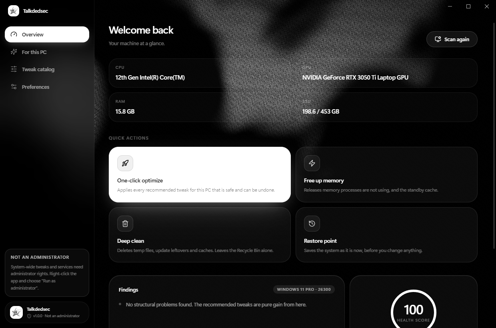
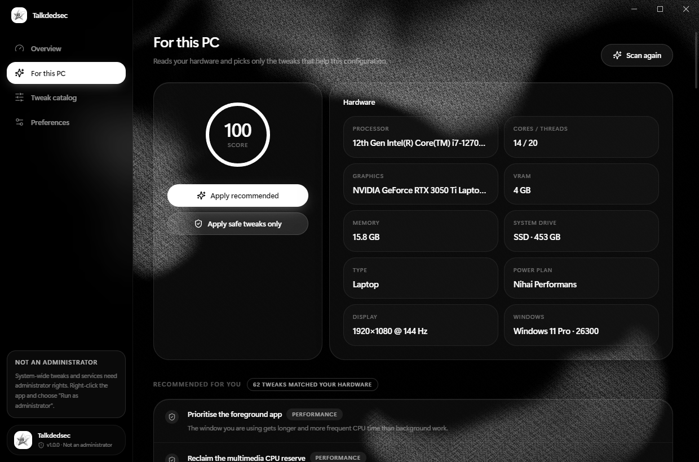
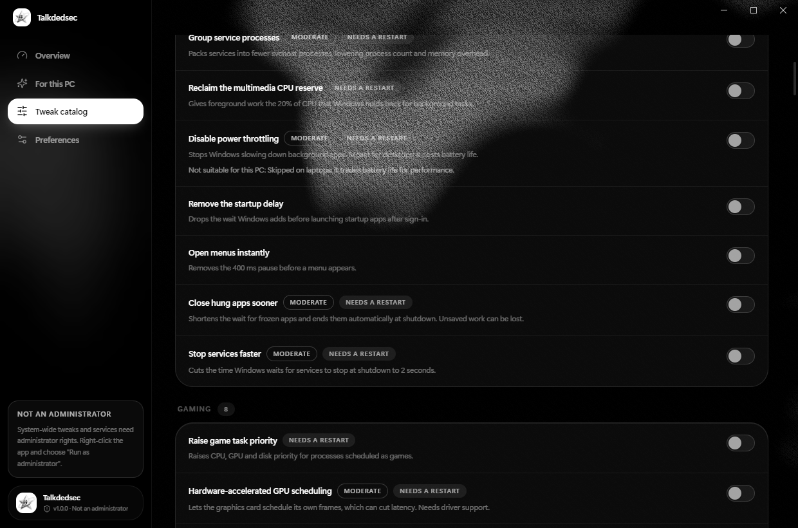
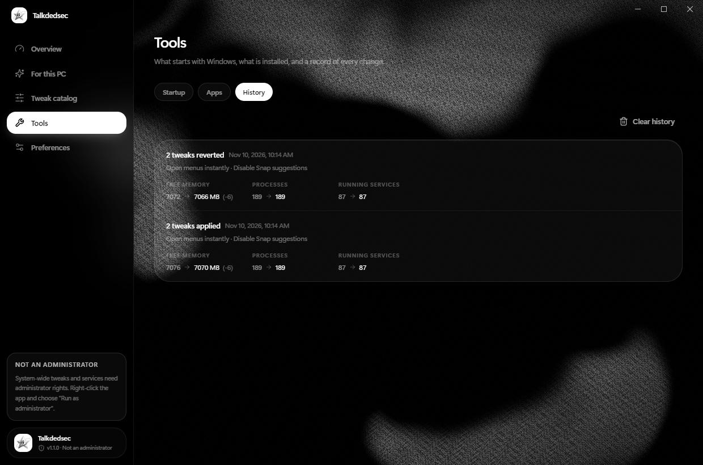

<div align="center">


# Talkdedsec

**Windows, tuned. Nothing final.**

114 performance, privacy and cleanup tweaks picked for your hardware,<br>
each one undoable with a click. No account, no telemetry.

[](https://github.com/Talkdedsec/talkdedsec-optimizer/actions/workflows/ci.yml)
[](https://github.com/Talkdedsec/talkdedsec-optimizer/releases/latest)
[](LICENSE)
[](#install)

[Website](https://talkdedsec.github.io/talkdedsec-optimizer/) · [Download](https://github.com/Talkdedsec/talkdedsec-optimizer/releases/latest) · [talkdedsec.com](https://talkdedsec.com) · [Türkçe](README.tr.md)



</div>

## What it does

- **Scans the machine, read-only.** CPU, GPU, memory, drive type, power plan, laptop or desktop.
- **Recommends only what fits.** Tweaks that cost battery or need hardware you do not have are skipped, with the reason shown.
- **Saves before it writes.** Each registry value is stored with its real type and each service with its start mode.
- **Undoes exactly.** Reverting restores the saved value, or removes the value if it did not exist before.
- **Manages what starts with Windows.** Switch startup entries off and on, the same way Task Manager does.
- **Shows what is already in place.** Tweaks that are already active on the PC, whoever made them, are marked in the catalog and left out of what gets applied.
- **Focus mode.** The app in front gets more CPU; the windowed apps behind it drop to low priority and efficiency mode, and the ones you pick are frozen until you return to them. Everything goes back when you turn it off.
- **Uninstalls and cleans up.** Removes programs and Windows apps, then shows the folders and registry keys left behind.
- **Keeps a history.** Every apply and revert is logged with free memory, process and service counts before and after.
- **Stays on your PC.** No sign-in, no telemetry. The only network request is an update check you can turn off.

| For this PC | Tweak catalog |
|---|---|
|  |  |

<p align="center"><br><sub>History</sub></p>

## Install

1. Download `Talkdedsec-Setup-1.2.1.exe` from the [latest release](https://github.com/Talkdedsec/talkdedsec-optimizer/releases/latest). Prefer no installation? Take `Talkdedsec-Portable-1.1.0.exe` instead.
2. Run it. The installer is not code-signed yet, so SmartScreen may ask: choose **More info > Run anyway**.
3. Start Talkdedsec. It asks for administrator rights because most tweaks write under `HKEY_LOCAL_MACHINE` or change services.

Requires Windows 10 or 11, 64-bit.

With [Scoop](https://scoop.sh):

```bash
scoop bucket add tlk https://github.com/Talkdedsec/scoop-tlk
```

```bash
scoop install talkdedsec
```

## Use

| Page | What you do there |
|---|---|
| **Overview** | See your hardware and health score, run one-click optimize, free memory, deep clean, create a restore point. |
| **For this PC** | Scan, then apply the recommended set or only the safe ones. |
| **Tweak catalog** | Search all 114 tweaks, switch each one on or off, see risk and restart badges. |
| **Tools** | Startup entries, installed apps with leftover cleanup, history of changes with before/after numbers, focus mode. |
| **Preferences** | Language (English, Turkish), restore point before applying, update check, export or import a tweak set, revert everything. |

Switching a tweak off restores what was there before. Risky tweaks ask for a second confirmation.

## The catalog

114 tweaks in 12 categories; 102 restore the exact previous value.

| Category | Tweaks | Category | Tweaks |
|---|---|---|---|
| Services | 28 | Power | 8 |
| Privacy | 15 | Storage | 8 |
| Maintenance | 11 | Display | 5 |
| Performance | 9 | Input | 5 |
| Network | 9 | Visual | 5 |
| Gaming | 8 | Memory | 3 |

Every entry is plain data in [`shared/tweaks.json`](shared/tweaks.json): a registry value, a service start mode or a short PowerShell step.

## Safety

- Without administrator rights, system-wide tweaks are refused instead of half-applied.
- If a tweak fails partway, the part already written is rolled back.
- Advanced or irreversible tweaks are never recommended automatically.
- Deep clean leaves the Recycle Bin and Prefetch alone.
- A restart is only offered and never force-closes open apps.
- Leftover folders go to the Recycle Bin and registry keys are exported before deletion; only paths named after the removed program are offered.
- Updates are verified against the SHA-256 digest GitHub recorded for the release before the installer runs.

Known limits: a few PowerShell-based tweaks (power plan, DNS) revert to the Windows default rather than a custom setting you had, and a delayed-start service comes back as plain automatic.

## Build from source

Needs Node.js 24 or newer.

```bash
git clone https://github.com/Talkdedsec/talkdedsec-optimizer.git
cd talkdedsec-optimizer
npm ci
npm test          # catalog checks and a real registry round trip under HKCU
npm run build     # type-check and bundle
npm start         # run the app
npm run dist      # build the installer and the portable exe into release/
```

| Path | Contents |
|---|---|
| `shared/` | Tweak catalog, titles and descriptions, shared types |
| `core/engine.ts` | Pure logic: apply and revert scripts, hardware fit, scoring |
| `core/ps.ts` | PowerShell runner, hardware scan, memory, cleanup, restore point |
| `core/tools.ts` | Startup manager, uninstaller, leftover search, before/after metrics |
| `core/focus.ts` | Focus mode: foreground watcher that boosts, throttles, freezes and restores processes |
| `core/main.ts` | Window, IPC, settings and backup store |
| `src/` | React interface |
| `docs/` | Project website |

## Security

Found a vulnerability? See [SECURITY.md](SECURITY.md). Please do not open a public issue.

## License

[MIT](LICENSE) © 2026 Talkdedsec · [talkdedsec.com](https://talkdedsec.com)
