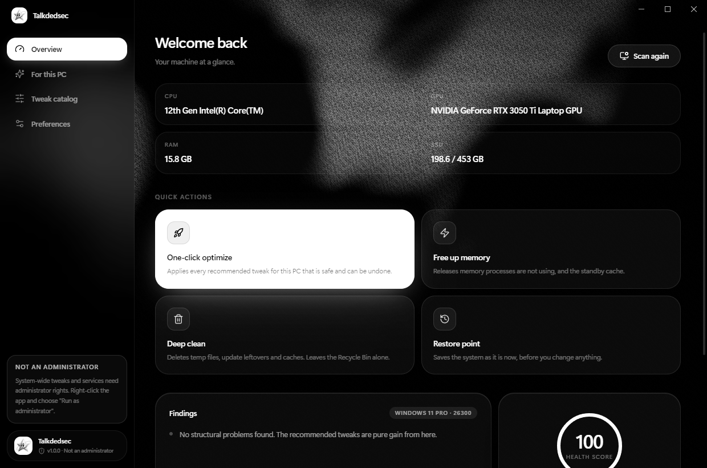
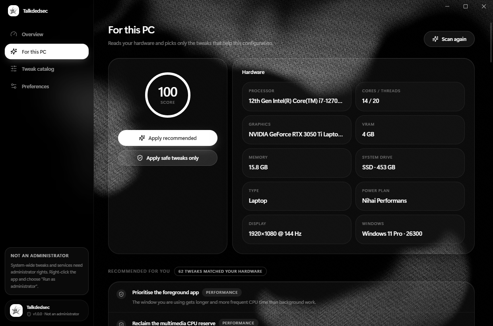
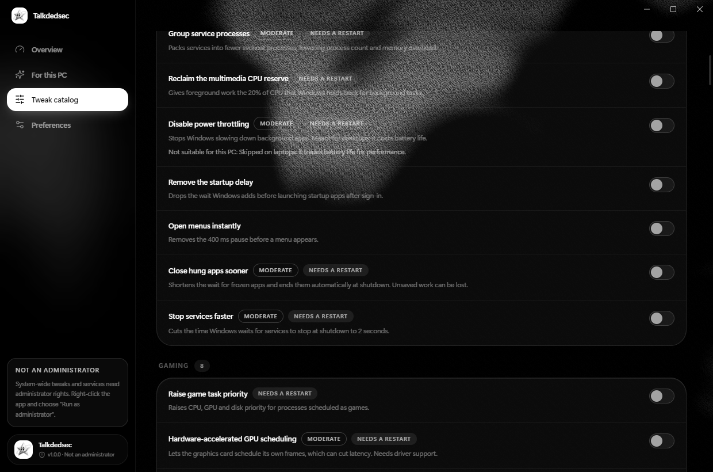

<div align="center">


# Talkdedsec

**Windows, ayarlı. Hiçbiri kalıcı değil.**

Donanımına göre seçilen 114 performans, gizlilik ve temizlik ayarı;<br>
her biri tek tıkla geri alınır. Hesap yok, telemetri yok.

[](https://github.com/Talkdedsec/talkdedsec-optimizer/actions/workflows/ci.yml)
[](https://github.com/Talkdedsec/talkdedsec-optimizer/releases/latest)
[](LICENSE)
[](#kurulum)

[Web sitesi](https://talkdedsec.github.io/talkdedsec-optimizer/) · [İndir](https://github.com/Talkdedsec/talkdedsec-optimizer/releases/latest) · [talkdedsec.com](https://talkdedsec.com) · [English](README.md)



</div>

## Ne yapar

- **Bilgisayarı salt okunur tarar.** İşlemci, ekran kartı, bellek, disk türü, güç planı, dizüstü ya da masaüstü.
- **Yalnızca uyanı önerir.** Pili tüketen ya da sende olmayan donanımı gerektiren ayarlar nedeni gösterilerek atlanır.
- **Yazmadan önce saklar.** Her kayıt defteri değeri gerçek türüyle, her servis başlangıç moduyla kaydedilir.
- **Tam olarak geri alır.** Geri alma saklanan değeri yükler; değer önceden yoksa siler.
- **Bilgisayarında kalır.** Giriş yok, telemetri yok, verini gönderen ağ kodu yok.

| Bu PC'ye özel | Ayar kataloğu |
|---|---|
|  |  |

## Kurulum

1. [Son sürümden](https://github.com/Talkdedsec/talkdedsec-optimizer/releases/latest) `Talkdedsec-Setup-1.0.0.exe` dosyasını indir.
2. Çalıştır. Kurulum dosyası henüz kod imzalı değil; SmartScreen sorarsa **Ek bilgi > Yine de çalıştır** de.
3. Talkdedsec'i aç. Ayarların çoğu `HKEY_LOCAL_MACHINE` altına yazdığı ya da servisleri değiştirdiği için yönetici yetkisi ister.

Windows 10 veya 11, 64 bit gerekir.

## Kullanım

| Sayfa | Ne yaparsın |
|---|---|
| **Genel bakış** | Donanımını ve sağlık puanını gör; tek tıkla optimize et, belleği boşalt, derin temizlik yap, geri yükleme noktası oluştur. |
| **Bu PC'ye özel** | Tara, sonra önerilen seti ya da yalnızca güvenli olanları uygula. |
| **Ayar kataloğu** | 114 ayarın tamamında ara, tek tek aç ya da kapat, risk ve yeniden başlatma etiketlerini gör. |
| **Tercihler** | Dil (Türkçe, İngilizce), uygulamadan önce geri yükleme noktası, her şeyi geri al. |

Bir ayarı kapatmak önceki değeri geri yükler. Riskli ayarlar ikinci bir onay ister.

## Katalog

12 kategoride 114 ayar; 102'si tam önceki değeri geri yükler.

| Kategori | Ayar | Kategori | Ayar |
|---|---|---|---|
| Servisler | 28 | Güç | 8 |
| Gizlilik | 15 | Depolama | 8 |
| Bakım | 11 | Ekran | 5 |
| Performans | 9 | Giriş | 5 |
| Ağ | 9 | Görsel | 5 |
| Oyun | 8 | Bellek | 3 |

Her kayıt [`shared/tweaks.json`](shared/tweaks.json) içinde düz veridir: bir kayıt defteri değeri, bir servis başlangıç modu ya da kısa bir PowerShell adımı.

## Güvenlik önlemleri

- Yönetici yetkisi yoksa sistem geneli ayarlar yarım uygulanmaz, reddedilir.
- Bir ayar yarıda başarısız olursa yazılan kısmı geri alınır.
- İleri düzey ya da geri alınamayan ayarlar asla otomatik önerilmez.
- Derin temizlik Geri Dönüşüm Kutusu'na ve Prefetch'e dokunmaz.
- Yeniden başlatma yalnızca önerilir, açık uygulamaları zorla kapatmaz.

Bilinen sınırlar: birkaç PowerShell tabanlı ayar (güç planı, DNS) senin özel ayarına değil Windows varsayılanına döner; gecikmeli başlayan servis geri alınınca düz otomatik olur.

## Kaynaktan derleme

Node.js 24 ya da üstü gerekir.

```bash
git clone https://github.com/Talkdedsec/talkdedsec-optimizer.git
cd talkdedsec-optimizer
npm ci
npm test          # katalog denetimleri ve HKCU altında gerçek kayıt defteri gidiş-dönüşü
npm run build     # tür denetimi ve paketleme
npm start         # uygulamayı çalıştır
npm run dist      # kurulum dosyasını release/ içine üret
```

| Yol | İçerik |
|---|---|
| `shared/` | Ayar kataloğu, başlık ve açıklamalar, ortak türler |
| `electron/engine.ts` | Saf mantık: uygula ve geri al betikleri, donanım uygunluğu, puanlama |
| `electron/ps.ts` | PowerShell çalıştırıcı, donanım taraması, bellek, temizlik, geri yükleme noktası |
| `electron/main.ts` | Pencere, IPC, ayar ve yedek deposu |
| `src/` | React arayüzü |
| `docs/` | Proje web sitesi |

## Güvenlik açığı bildirimi

Bir açık mı buldun? [SECURITY.md](SECURITY.md) dosyasına bak. Lütfen herkese açık issue açma.

## Lisans

[MIT](LICENSE) © 2026 Talkdedsec · [talkdedsec.com](https://talkdedsec.com)
